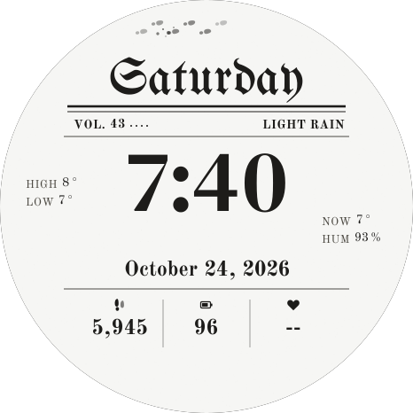
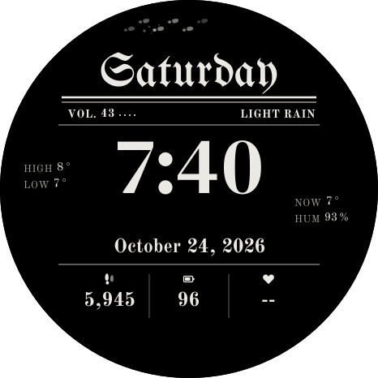
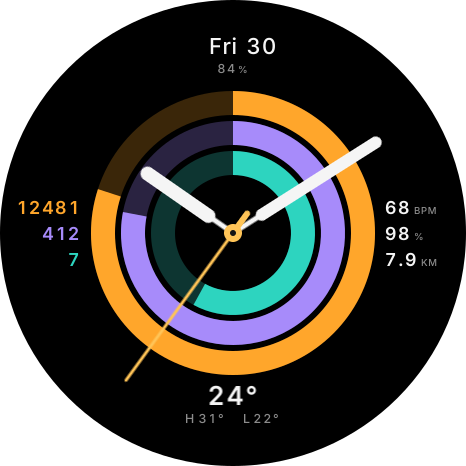

# Amazfit Active 2 watch faces

Six free Zepp OS watch faces for the **Amazfit Active 2 (Round)**, 466 × 466. They won't fit square
models (Active 2 Square, Bip, GTS). Ember's package also targets other round Zepp OS watches, but has
only been tried on the Active 2.

| Mischief Gazette | Mischief Gazette Dark | Halo |
|---|---|---|
|  |  |  |

Previews use sample values; the watch shows your own data.

| Face | Style | Shows |
|---|---|---|
| Mischief Gazette | Newspaper front page on white paper; footprints cross the masthead when you raise your wrist | Weekday, issue (week) number, forecast, high/low, current temp, humidity, time, date, steps, battery, heart rate |
| Mischief Gazette Dark | Same, on true black for AMOLED | Same |
| Halo | Analog hands over three animated activity rings, gliding second hand | Steps, calories, stand hours, heart rate, SpO2, distance, battery, weather |
| Tonal | Stacked digital time, Material 3 colours | Steps, battery, heart rate, seconds ring |
| Orbit | Digital time with a 60-tick minute ring | Steps, calories, stand, distance, heart rate, SpO2, battery, high/low |
| Ember | Simple digital time | Steps, battery, heart rate |

## Install

Download a `.zab` from [`install-files/`](install-files). Zepp's own app doesn't open `.zab` files
directly, so use a third-party installer that supports Zepp OS watches, and check it supports the
Active 2 first.

## Privacy

The faces read health and weather data on the watch to display it. They make no network requests and
send nothing anywhere.

## Battery

- Halo's gliding second hand redraws about 30 times a second while the screen is on, and stops when
  it turns off.
- The white Mischief Gazette lights most of the AMOLED screen; Dark is the low-power version.

## Building from source

Each `*-face/` folder is a Zeus CLI project. Install the CLI with `npm i -g @zeppos/zeus-cli`, then in
a face folder run `zeus build` (makes `dist/*.zab`) or `zeus preview` (QR code for your own watch,
needs `zeus login` and Developer Mode in the Zepp app).

The generated images in each `assets/` folder are committed, so a plain build needs nothing else.
To regenerate them, run `npm install` in `zeus-tools/fontgen`, then:

- Mischief Gazette (both versions): `cd gazette-face && node make-assets.cjs light && node make-assets.cjs dark`,
  and `node check.cjs` / `node check.cjs ../gazette-dark-face` to run the layout and behaviour checks.
  The dark face's `watchface/index.js` is copied from `gazette-face`, so edit it there.
- Halo: `cd halo-face && node make-assets.js && node make-glyphs.js ../zeus-tools/fontgen/fonts`

## Credits

- Fonts, all under the SIL Open Font License (texts in [`font-licences/`](font-licences)): Inter,
  Unifraktur Maguntia, DM Serif Display, Old Standard TT.
- Mischief Gazette is inspired by a newspaper-style watch face by [ADD DESIGNER CREDIT].
- Tonal's colours were generated with Google's open-source Material Color Utilities.
